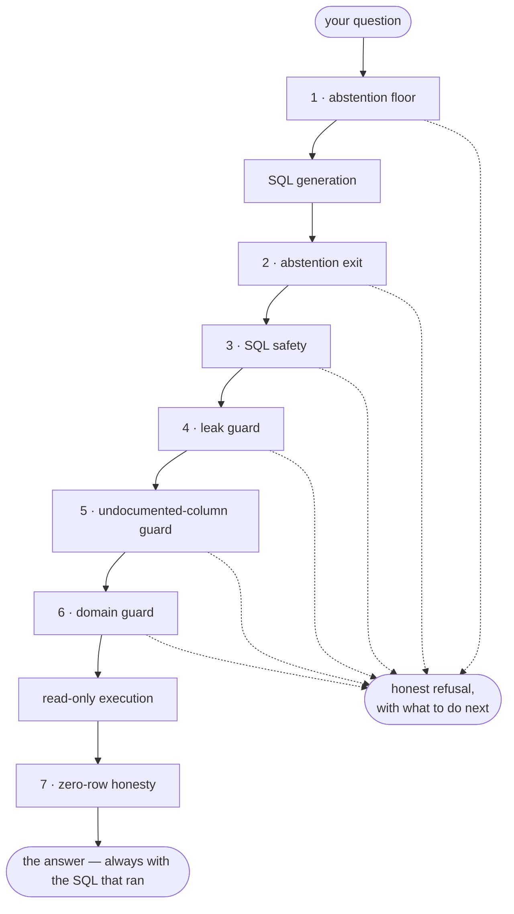

# Ask honesty — the five guards

!!! info "Which builds can run this"
    The guards run in every edition. Asking needs the `rag` and `llm` modules: an Open build
    lists only `core` and `identity` in `lm module list`, and a hub with the AI switched off
    lists `rag` and `llm` as `INACTIVE`.

When you ask your data an **analytic** question, lumnik translates it to SQL and runs it read-only
over the hub. `lm ask`, the TUI's `:ask` and the PWA chat all go through the same guards. Semantic
chat (`lm chat`) cites ingested chunks and generates no SQL, so the guards do not apply there.

The guards enforce one principle — the *asymmetry of harm*:

> A refusal costs you a retry. A confident wrong answer — especially a confident **"there are
> none"** when there are some — costs you a business decision. lumnik always prefers the refusal.

Every refusal below is deterministic (no model judges the veto), and each message says what to do
next. In the quoted messages, `<bracketed>` parts and `…` stand for your actual value, column, table
and lists.

## The pipeline, in order

Seven stages: abstention counts once though it stands at two points, and SQL safety sits beneath
the guards.



Stages 1–6 each eject to a refusal when they trigger. Stage 7 never refuses — an
empty result is delivered with a caveat, never phrased as a confident *"there are none"*.

### 1. Abstention floor — nothing declared yet

**Trigger:** the scope has no schema at all (no tables, or tables without columns).

> I have no data declared for this scope yet, so I can't answer that. Ingest a source for this scope first.

**Do next:** apply a connector with `metadata.scopes: [<your-scope>]` and run it.

A stored schema card that cannot be **read** is refused the same way:

> The stored schema card for scope '`<scope>`' cannot be read (…) — re-run discovery, or apply the entity again, to replace it.

### 2. Abstention exit — the model's honest "I can't"

**Trigger:** the SQL-generation model concludes the question doesn't map to the declared schema
and emits its sentinel (`NO_ANSWER`) instead of guessing a query.

Before refusing, the hub asks the model once to rewrite the question as one complete sentence, and
tries again. This is what lets a terse lookup such as `status SO-000004` through. The answer is still
phrased for the question as you typed it.

> I can't answer that from the data available for this scope — the question doesn't map to the declared schema.

**Do next:** rephrase using the columns the scope actually declares (`lm view` shows them), or
ingest/declare the missing data.

Two questions abstain because the analytic door cannot read what answers them. The refusal adds a
sentence saying where the answer is:

| Question | The refusal adds | Where you go next |
|---|---|---|
| "why can't this document move on?" | this scope **does** declare a `kind: Workflow` lifecycle | `lm chat` (semantic chat reads the lifecycle) |
| "where do the ERP and the CRM disagree?" | the disagreement **is** recorded on each fused record | `lm conflicts list`, or the record's detail view in the PWA |

- The sentence appears only when the question is about a disagreement or a lifecycle (stages, a
  transition, a blocked document; in French or English). A plain status lookup does not get it.
- `lm ask` then prints a `try:` line naming `lm chat` or `lm conflicts list`.

!!! note "Sometimes the abstention fires before a more specific guard"
    Ask about a value outside a declared domain (a `segment` that doesn't exist) and the model may
    abstain before the domain guard names the mismatch. Re-ask with a declared value to see the
    specific hint.

### 3. SQL safety — read-only, bounded

**Trigger:** the generated SQL is anything but one clean read: not a single `SELECT`/`WITH`
statement, multiple statements, or a banned token (DML/DDL keywords, `pg_sleep`, `pg_catalog`,
`information_schema`, `dblink`, …).

> I couldn't translate that into a safe query.

Accepted queries are capped with `LIMIT 500` (a larger `LIMIT` is lowered) and run read-only.
Every table must be schema-qualified (`connector.v_acmecustomer`).

### 4. Leak guard — the métier boundary

**Trigger:** the query reads a table that is not declared in this scope's card — the *scope*
boundary within a tenant. A [scope-bound user](../rag/scopes.md#binding-users-to-scopes-opt-in)
asking a scope they do not hold gets `403 scope not granted` before any SQL is generated.

> I won't run this: '`<schema.table>`' is not a table in this scope (declared: …). The query may not read data outside this métier's declared scope.

**Do next:** switch to the scope that owns the table (`lm scopes`), or add this scope to the
connector's `metadata.scopes` and re-run it.

### 5. Undocumented-column guard

**Trigger:** the query filters a column that is declared in **no** table of the scope — an
invented column, or an internal one (`tenant_id`, `_row_hash`) the chat was never meant to
reason over.

> I won't run this: '`<column>`' is not a declared column of this scope (known: …). If it should exist, add it to the entity manifest.

(The "known" list is capped at 12 names to keep the message readable.)

### 6. Domain guard — the declared-values contract

**Trigger:** the query filters a column on a literal that is **not** in that column's declared
`values:` list (entity manifest). Without it, the query would return 0 rows for the wrong reason.

> I won't run this: '`<value>`' is not a declared value of `<column>` (known: …). If it should exist, add it to the entity manifest.

**Do next:** if the value is legitimate, add it to the entity manifest's declared values and
re-apply; if it was a typo, re-ask with a declared value.

### 7. Zero-row honesty — never a confident negative

**Trigger:** the query ran fine and returned 0 rows.

> The query returned no rows. That can mean there are genuinely none, or that the query did not capture your question — verify the SQL before reporting that there are none.

The SQL that ran is always shown with the answer (`lm ask` prints it; the TUI yanks it with `y`).

Two more answers come from the query run itself, not from a guard:

- **A filter matches more than one row** — e.g. a customer name that isn't unique:

  > That filter matches `<N>` rows, so the question has no single answer. Matching `<column>`: `<id-1>`, `<id-2>`, …. Ask again naming one of them — for example by filtering on `<column>` instead of the name.

  `<N>` may read "at least `<N>`". The list stops at 10 values, then ", and `<k>` more".

- **Any other read failure** (a syntax error, a permission or timeout issue):

  > I couldn't run that query — the database refused it: `<reason>` The SQL is below; if it looks
  > wrong for this scope, re-run discovery.

  `<reason>` is the database's first line for SQLSTATE classes `21`, `42`, `53`, `54` and `57`. Any
  other class reads `SQLSTATE <code> (the message is withheld — that class can carry stored values;
  the server log has it).`

## A long result — what the answer is written from

A question can match hundreds of rows. The answer is written from the first rows only (about fifty
catalogue rows), and **its first sentence says so** — a sentence the hub writes, not the model:

```
$ lm ask --scope pwa-chat "Give me the references and descriptions of the items whose description does not contain Badu"
The answer summarises the first 48 of the 312 rows returned.
312 references do not mention Badu in their description; they are pumps and pool accessories.
  data as of: 2026-10-14T17:21:04Z (last completed run)

…
  312 rows returned

  SQL: SELECT "reference", "description" FROM "connector"."v_pwachatproduct" WHERE "description" NOT ILIKE '%Badu%'
LIMIT 500
```

- **Nothing is lost.** `lm ask` prints every row (cut at `…` above), then the count and the SQL;
  `lm ask -o json` gives the whole result ([see both](../cli/lm-reference.md#the-rows-under-the-answer)).
  The PWA chat shows the answer and the SQL, not the rows.
- **The summary does not count for you.** For an exact figure, ask for it: *"how many items do not
  contain Badu?"* is answered by a query.
- **A result cut at its limit says so.** A query returns at most 500 rows; when it stops there, or at
  a smaller `LIMIT` of its own, the answer ends with a line:

```
$ lm ask --scope pwa-chat "List all the items"
The answer summarises the first 48 of at least 500 rows.
The catalogue holds pumps, filters, covers and chemical products.

The SQL query stops at 500 rows: there may be more.
```

- **The figures are still checked against the rows** (see below); the hub's own sentences are not.
- **If the answer could not be written** (the model was too slow, or failed), you get the rows and the
  SQL, and `abstained: true`. Ask again, or narrow the question.

Tune the size of the sample with `LUMNIK_ASK_ANSWER_BUDGET_CHARS` (default `6000`; see
[models](../rag/models.md#analytic-text-to-sql-ask-qwen25-coder7b)).

## Unbacked figures — the phrased answer checked against its rows

Every standalone number in the model's sentence must be backed by the rows: the row count, a cell, or
a numeric column's sum, minimum, maximum or average at the precision written. Otherwise the sentence
is withheld, never the rows:

> The phrased answer stated a figure these rows do not back, so it is withheld. The rows and the SQL below are the answer.

`lm ask` prints those rows in a table under that sentence, then the SQL. For a script, `lm ask -o json` marks the
result `"abstained": true` ([see both](../cli/lm-reference.md#the-rows-under-the-answer)).

- It catches a figure the model took from an ingested text that reads like an instruction.
- Not numbers: identifiers (`SO-000004`), dates, list markers. Grouped thousands (`1,250`,
  `312 480`) are one figure. A number quoted from a text cell with its words is a quote, not a claim.
- It cannot see a cell that already holds a false sentence: an answer repeating it passes.

## Disputed rows — a disclosure, not a veto

This one never stops an answer: it adds to one.

A fused entity keeps one value per column; the other sources' values are in its `_conflicts`
ledger. P-1008 is Lyon in the ERP and Villeurbanne in the CRM, so *"GOLD customers in Lyon"* counts
it and *"customers in Villeurbanne"* does not. The answer names such records, per filtered column:

- **counted** — a record the answer counted on a value its sources dispute;
- **not counted** — a record the filter left out although a source holds the filtered value.

```
  disputed — a source disagrees on a value this answer filtered on:
    P-1008  city = 'Villeurbanne'  not counted  t_acme_desk_erp: Lyon · t_acme_desk_crm: Villeurbanne
```

| | |
|---|---|
| **Appears on** | answered and zero-row results; never after a guard refusal or a read failure |
| **Query shapes** | one fused entity view, filtered with `col = 'v'` or `col IN (…)` joined by `AND` |
| **No disclosure for** | `OR`, `NOT`, `<>`, `!=`, `NOT IN`, ranges, `LIKE`, joins, subqueries, `UNION`/`INTERSECT`/`EXCEPT`, `resolution:` entities, a lookup that fails or takes over 5 s |
| **Counted entries** | only when the record demonstrably contributed: never with `HAVING`; on an aggregate-only query, not with `OFFSET`; otherwise not with `LIMIT`, `OFFSET`, `FETCH` or at the 500-row cap |
| **Cap** | 10 entries, not-counted first; `disputedTruncated` says when more exist |
| **Isolation** | your tenant only, read-only |

A missed disclosure is possible; a false one is not. The model's answer text is untouched. Each
door renders it: [`lm ask`](../cli/lm-reference.md#the-rows-under-the-answer), the
[analytic response](../rag/http-api.md#analytic-response-mode-analytic),
[the PWA chat](../apps/pwa.md#chat-ask-your-data).

## Fail-open by design

The value, column and table guards inspect only clean SQL shapes (bare identifiers compared to
string literals). A function-wrapped column (`lower(col) = …`), a column qualified by anything but
the table's alias, or a name ambiguous across tables is not refused.

## Names the source chose

A column keeps the name its source gave it: `c_bpartner.id`, `Partner Name`, `MONTANT_€`. The
schema card lists every column **quoted**, the generated SQL quotes them, and a refusal names one in
full (`montant_€_ht` stays `montant_€_ht`). Use the name exactly as `lm source schema` lists it.

A kafka source has no rename step, so the producer's field name is the column name; a CSV or JDBC
source can [rename on the way in](../connectors/jdbc.md#per-table-keys). A
[`kind: Workflow`](../apps/workflows.md#names-the-source-chose) uses the column's real name too.

## Asking for a name, asking for a text

A question pins a value in one of two ways; the SQL under the answer shows which.

| The question says | The SQL | Example |
|---|---|---|
| a name: a category, a status, a code | exact match | *« … de la catégorie Pompes ? »* → `"category_name" = 'Pompes'` (not `Pompes à chaleur`) |
| a text column **contains** a text | anywhere in the value, any case | *« dont la description contient Badu »* → `"description" ILIKE '%Badu%'` |
| both | the name exact, the text searched | *« … de la catégorie Pompes dont la description contient Badu »* |
| a negation | the opposite set | *« qui ne contient pas Badu »* |
| another wording | left to the model: it may abstain or miss `BADU` | *« Quels articles mentionnent Badu ? »* names no column and abstains |

- Search wordings name a text column (description, libellé, désignation, nom, texte, intitulé, titre,
  commentaire, or the English words) with *contient*, *inclut*, *mentionne* / *contains*, *includes*,
  *mentions*, or put the text in the column (*« Badu dans la description »*).
- A value named right after *catégorie*, *statut* or *code* (*category*, *status*, *code*) is always
  matched exactly: the hub turns an `ILIKE '%Pompes%'` on it back into `= 'Pompes'`, and the SQL shown
  is the one that ran.
- *« Combien d'articles contient la catégorie Pompes ? »* is not a text search: a category is not a
  text column.

A count that looks too high on a named value: check the SQL for `=` (a name) or `ILIKE` (a search).

## Asking about a date

A date the question writes is a filter, and the column's type decides how:

| The question says | On a date column | On a timestamp column |
|---|---|---|
| a day, *« … le 2026-07-02 »* | `= '2026-07-02'` | the whole day: `>= '2026-07-02' AND < '2026-07-03'` |
| a month, *« … en juillet 2026 après le 4 »* | `>= '2026-07-05' AND < '2026-08-01'` | the same range |
| a day no row holds | no row, with the zero-row caveat — not a refusal | the same |

- The wordings are an ISO date (`2026-07-02`, a time after it allowed) or a month with its year (*juillet 2026*,
  *1er juillet 2026*, *July 2026*, *July 2, 2026*). `01/07/2026` (first of July or seventh of January?), *hier*, an
  abbreviated month (*juil. 2026*), a year alone, a code built from a date (`SO-2026-07-02`, `SO/2026-07-02`, asked
  for by its exact value) or a day the calendar does not have (`2026-02-31`) are left to the model.
- A day is the platform's midnight UTC, as everywhere else: Ask reads in UTC whatever zone the hub runs in.
- The column must carry a date type. A date a source landed as text (a CSV without
  [`parse-date`](../connectors/transformers.md#parse-date-dates-are-31122019)) is compared as text; on an entity, see
  [Dates across sources](../entities.md#dates-across-sources).
- The model may count where you asked for the list (*« Quelles commandes… »* answered with `COUNT(*)`): the range is
  right, the SQL shows the shape.

## A question that follows the previous one

*« Et HAWARD ? »* means nothing on its own. The PWA chat sends the previous question with it (the
`previous` field of the [chat door](../rag/http-api.md#follow-up-questions)); `lm ask` does not. The hub
rewrites the follow-up as one complete question and answers **that** through every guard above.

The memory is one sentence — the previous question, never its rows or SQL:

```text
Donne-moi les références dont la description contient Badu.
Et HAWARD ?                                   → Donne-moi les références dont la description contient HAWARD.
Et PENTAIR ?                                  → Donne-moi les références dont la description contient PENTAIR.
Et seulement celles de la catégorie Pompes ?  → Donne-moi les références de la catégorie Pompes dont la description contient PENTAIR.
```

| The follow-up | Effect |
|---|---|
| *« Et X ? »*, *"And X?"* — a bare value | **replaces** a value: HAWARD then PENTAIR searches PENTAIR, never both |
| *« seulement »*, *« uniquement »*, *« parmi elles »*, *"only"*, *"among them"* | **narrows**: the earlier conditions stay, the new one is added |
| *« aussi »*, *« également »*, *"also"*, *"as well"* | **widens**: the new value is accepted beside the old one |
| a complete question | answered as asked |

A value is recognised when written in capitals (*HAWARD*), with a digit (*SO-000005*), between quotes,
or capitalised inside the sentence (*Pentair*). All in lower case (as on a phone), it is recognised
only when the previous question searched exactly one text, one word or quoted text ending its clause:

```text
Donne-moi les références dont la description contient badu.
et haward ?    → Donne-moi les références dont la description contient haward.
et pentair ?   → Donne-moi les références dont la description contient pentair.
```

- Words of conversation (*« et alors ? »*, *« Et Ensuite ? »*, *"and then?"*) are never taken as a
  value; a word not on that list is (*« et bof ? »* searches *bof*).
- When in doubt, write the value as the data spells it, or ask in full.

Every other follow-up is written by the model, and the hub checks it before using it. It is refused, not guessed, when:

- a value of your follow-up is not in it exactly as you wrote it (*HAWARD* corrected to *Hayward* would search
  something else);
- it names a value that is in neither sentence (an invented filter);
- it adds a value where *« Et X ? »* should replace one (*contient badu ou haward*);
- it searches a text when neither sentence asked for a text search
  ([above](#asking-for-a-name-asking-for-a-text): that is the asker's call, never the model's);
- the model says the follow-up points at something the previous question does not name.

A follow-up that points at a row of the answer (*« le deuxième »*, *« la première est… »*, *« celui-ci »*, *« ce
client-là »*, *"the second one"*, *"that one"*) is refused before the model is asked: the rows are never remembered.
An ordinal on a noun (*« le mois dernier »*, *« le premier trimestre »*) is not a row.

> I couldn't tie this question to the previous one. Ask it in full, with the value or the name it refers to.

**Do next:** ask the question in full.

The answer comes with the question it answers (`understoodAs`). Read it the way you read the SQL: it is what was
really asked.

A leading address to the chat is removed: *« lumnik, combien de clients ? »*, *« Dis lumnik … »*,
*"Hey lumnik …"* (followed by a comma, a colon or `!`, or after a greeting). *« lumnik a combien de
commandes ? »* keeps lumnik as a value.

## When an answer looks wrong

The guards lower the odds; they do not abolish them.

1. **Detect** — read the SQL that came with the answer.
2. **Report** — to your integrator (the
   [security contact](https://github.com/icreated/lumnik/blob/main/SECURITY.md) is for
   vulnerabilities only).
3. **Fix** — a value or column the guards should have known: add it to the entity manifest and
   re-apply it (`lm source rediscover --scope <tag>` rebuilds the card if needed).
4. **Re-verify** — ask the same questions again; the SQL makes each one replayable.

## See also

- [Ingestion honesty](ingestion-honesty.md) — the same principle on the way *in* (DLQ, quarantine,
  run transparency).
- [Scopes](../rag/scopes.md) — what a scope is and what the leak guard guarantees.
- [View generation contract](../apps/views.md#generation-contract) — the same abstention ethos when
  the AI *writes* a `kind: View`: unanswerable ask → refusal with the reason, never invented columns.
