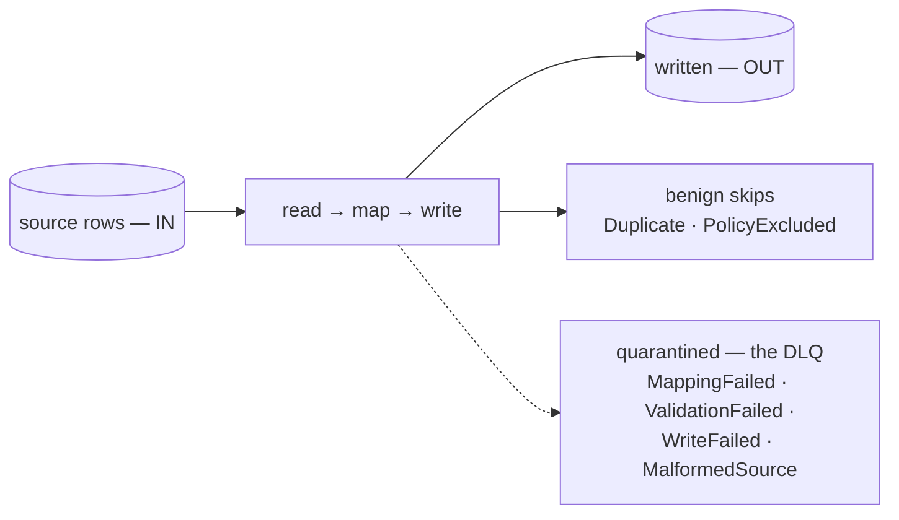

# Seeing what was ingested, skipped, and quarantined

> A connector run cannot look clean while it lost rows. This page reads a run's arithmetic —
> what the counters mean, which non-writes are benign, and how to get from a count to the exact
> row that fell out, with its reason.



Every row is written, benignly skipped, or quarantined with its reason and payload:
`IN = OUT + SKIPPED`. The dashed path is what `DEAD-LETTERS` counts.

## The two kinds of "not written"

| Kind | Reasons | In `DEAD-LETTERS`? |
|---|---|---|
| **Benign skip** | `Duplicate` (the row already existed), `PolicyExcluded` (a `filter-where` or `skip-empty-rows` hook excluded it) | no |
| **Quarantined (dead letter)** | `MalformedSource`, `MappingFailed`, `ValidationFailed` (a `validate-row` hook), `WriteFailed` | yes |

`OUT` counts **source rows**: a `split-row` hook that fans one row into several table rows still
counts one.

## Reading a run

`lm run get <id>` shows `IN`, `OUT`, `SKIPPED` and `DEAD-LETTERS` (always part of `SKIPPED`). A
ten-row orders export where two lines do not match the header:

```
$ lm run get 8ffcd5ae
ID        CONNECTOR  ENDPOINT  STATUS     IN  OUT  SKIPPED  DEAD-LETTERS  STARTED           ENDED
8ffcd5ae  orders     default   Completed  10  8    2        2             2026-10-19 01:47  2026-10-19 01:47
⚠ 2 rows quarantined — see: lm dlq list --run 8ffcd5ae-c387-45b9-8a57-091043af6c59
```

`10 = 8 + 2`, and both skipped rows are dead letters. `--run` takes the full id or its first
8 characters.

The run can print three other notes (on stderr):

| Note | Means |
|---|---|
| `⚠ N cell(s) a hook did not deliver as declared — the rows were still written` | a lead, not a loss — see the table below |
| `• N row(s) removed — the source no longer holds them` | rows left the table — see below |
| `✖ run failed: …` (`• run cancelled: …` for a cancelled run) | the reason the run ended |

A cell a hook did not deliver as declared — the row still landed and counts in `OUT`, and nothing
goes to the DLQ:

| Shape | What happened to the cell |
|---|---|
| emptied | a hook could not read the value; the cell was written empty |
| declined | a repair hook left the value exactly as it arrived (repairing it would have lost more) |
| replaced | a value the source never sent, where the manifest asks for it by name |
| overwritten | a value from another column that a rename landed on |

Rows **removed**:

- **csv, one local file**: the rows the file no longer holds. The run fails instead, and removes
  nothing, when it would remove more than 30% of the table (`refresh.max_removed`), when the file
  is empty, when it has dead letters, or when the file changed while it was read — see
  [CSV § full refresh](../connectors/csv.md#one-file-is-the-table-full-refresh).
- **jdbc**: the older versions of a key, once — see
  [Upgrading](../operations/upgrade.md#a-jdbc-table-now-holds-one-row-per-key).

```
$ lm run get a569be52
ID        CONNECTOR  ENDPOINT  STATUS  IN  OUT  SKIPPED  DEAD-LETTERS  STARTED           ENDED
a569be52  orders     default   Failed  5   5    0        0             2026-10-19 01:47  2026-10-19 01:47
✖ run failed: 3 of 8 rows would be removed: the file holds 5 where the table held 8, more than refresh.max_removed (30%) allows — nothing was removed. If the file really lost them, raise refresh.max_removed (or set it to off) and run again.
```

## A run that refuses to finish

When a chunk reads records but the endpoint's stored position does not move, the next chunk
would read the same rows for ever. The run stops itself and ends **Failed**, naming the endpoint:

    ✖ run failed: endpoint 'order_lines' read 500 records but its stored position did not move — the same window would be re-read for ever

Nothing was lost: the rows read were written, and re-reading them is not a duplicate. Re-running
reproduces it, because the position is stored.

## Seeing why

- `lm dlq list --run <id>` — every dead letter of the run (reason, attempts, message).
- `lm dlq get <id>` — the full reason and the **offending payload** (the exact row). The
  8-character id from the list works; keep the same `--run` so it resolves against that list.

```
$ lm dlq list --run 8ffcd5ae-c387-45b9-8a57-091043af6c59
ID        CONNECTOR  RUN       REASON           ATTEMPTS  MESSAGE
e4d33067  orders     8ffcd5ae  MalformedSource  1         /tmp/drop/orders.csv:9 — Index for header 'status' is 2 but …
5b15008d  orders     8ffcd5ae  MalformedSource  1         /tmp/drop/orders.csv:8 — Record has 6 values but only 5 colu…

$ lm dlq get 5b15008d --run 8ffcd5ae-c387-45b9-8a57-091043af6c59
ID:        5b15008d-eec6-404d-b9f4-35f7d75121c9
Connector: orders (ede74f60-6705-4388-9d62-ed4a55d6c0f4)
Run:       8ffcd5ae-c387-45b9-8a57-091043af6c59
Reason:    MalformedSource
Attempts:  1
Message:   /tmp/drop/orders.csv:8 — Record has 6 values but only 5 columns are declared
Detail:    {"file":"/tmp/drop/orders.csv","line":8,"message":"Record has 6 values but only 5 columns are declared"}
Payload:   {"raw":["ORD-1007","C-001","IN_PROGRESS","640.00","","extra"],"file":"/tmp/drop/orders.csv","line":8}
```

Line 8 carried six values for five columns. The payload keeps every raw value: fix it in the
export, then close the entry with `lm dlq discard` or `lm dlq replayed`.

## Metrics

The Prometheus endpoint (`/q/metrics`) exposes:

- `lumnik_runs_total{status}` — runs by terminal status (`Completed`, `Partial`, `Failed`,
  `Cancelled`). `Partial`: the run wrote everything it read, but stopped before reading
  everything there was.
- `lumnik_dead_letters_total{reason}` — quarantined rows by reason.

No dashboards ship with lumnik; wire these into your own monitoring.
