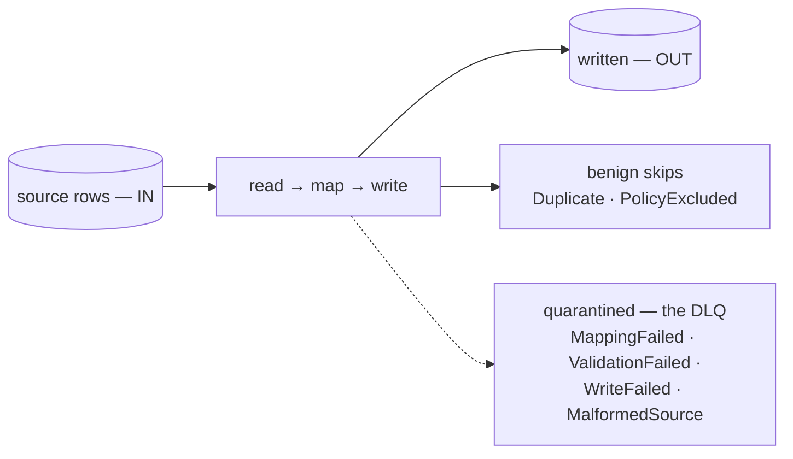

# Seeing what was ingested, skipped, and quarantined

> A connector run is honest: it can never look clean while it silently lost rows. This page
> reads a run's arithmetic — what the counters mean, which non-writes are benign, and how to
> get from a count to the exact row that fell out, carrying its reason.

Every row is accounted for — written, benignly skipped, or quarantined with its reason
and payload. The dashed path is the one `deadLetterCount` counts.

## The two kinds of "not written"

- **Benign skips** — a row that already existed (`Duplicate`) or was excluded by
  policy (`PolicyExcluded`). Not a loss, so it is **excluded from `deadLetterCount`**
  (a skip is not a quarantined row).
- **Quarantined rows (dead-letters)** — a row that did not make it in, captured
  with its reason: `MappingFailed`, `ValidationFailed`, `WriteFailed`,
  `MalformedSource`. These are real losses and are what `deadLetterCount` counts.

Every tier a row passes through joins this same arithmetic — the reader, the mapping
hooks (`filter-where`/`skip-empty-rows` → `PolicyExcluded`, `validate-row` →
`ValidationFailed`), and the writer (`Duplicate`, `WriteFailed`) — not the writer
alone. `records_out` counts **source rows**, not target-table rows: a `split-row`
hook that fans one source row into several table rows still counts as one `OUT`.

## Reading a run

`lm run get <id>` shows `IN`, `OUT`, `SKIPPED`, and `DEAD-LETTERS` — `DEAD-LETTERS`
is always a subset of `SKIPPED` (a benign skip is never DLQ'd). When any rows were
quarantined it prints:

    ⚠ N rows quarantined — see: lm dlq list --run <id>

A run can print a **second** warning, which is not a loss:

    ⚠ N cell(s) emptied by a parse hook that could not read the value

That one counts *cells*, not rows: a parse hook could not read a value, so the cell was
written empty — **the row itself still landed** and still counts in `OUT`. It is a lead to
follow in the source data or the transformer, never a quarantine, and it never appears in
the DLQ.

## Seeing why

- `lm dlq list --run <id>` — every dead-letter the run produced (reason, attempts, message).
- `lm dlq get <id>` — the full reason detail and the **offending payload** (the exact row that failed).

## Metrics

The Prometheus endpoint (`/q/metrics`) exposes:

- `lumnik_runs_total{status}` — runs by terminal status.
- `lumnik_dead_letters_total{reason}` — quarantined rows by reason.

No dashboards ship with lumnik; wire these into your own monitoring if desired.
