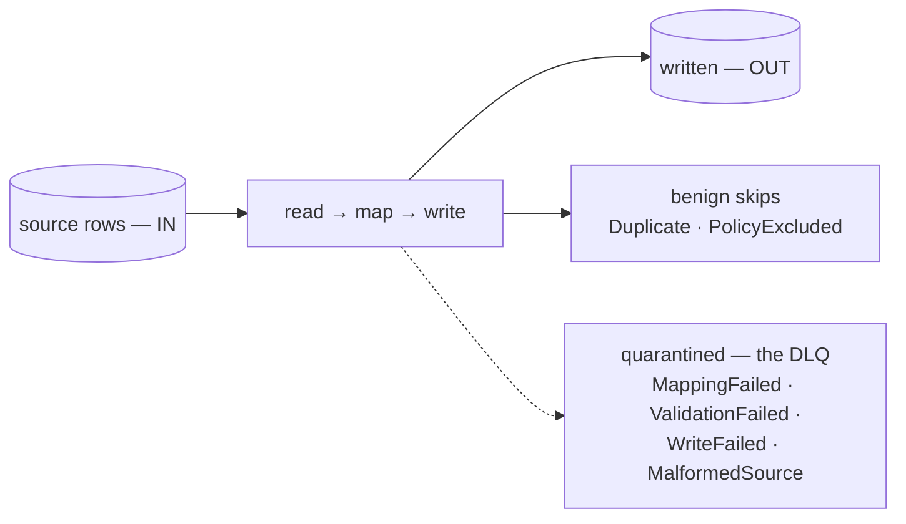

# Seeing what was ingested, skipped, and quarantined

> A connector run is honest: it can never look clean while it silently lost rows. This page
> reads a run's arithmetic — what the counters mean, which non-writes are benign, and how to
> get from a count to the exact row that fell out, carrying its reason.



Every row is accounted for — written, benignly skipped, or quarantined with its reason
and payload. The dashed path is the one `deadLetterCount` counts.

## The two kinds of "not written"

- **Benign skips** — a row that already existed (`Duplicate`) or was excluded by
  policy (`PolicyExcluded`). Not a loss, so it is **excluded from `deadLetterCount`**
  (a skip is not a quarantined row).
- **Quarantined rows (dead-letters)** — a row that did not make it in, captured
  with its reason: `MappingFailed`, `ValidationFailed`, `WriteFailed`,
  `MalformedSource`. These are real losses and are what `deadLetterCount` counts.

Every tier a row passes through joins this same arithmetic — the reader, the mapping
hooks (`filter-where`/`skip-empty-rows` → `PolicyExcluded`, `validate-row` →
`ValidationFailed`), and the writer (`Duplicate`, `WriteFailed`) — not the writer
alone. `records_out` counts **source rows**, not target-table rows: a `split-row`
hook that fans one source row into several table rows still counts as one `OUT`.

## Reading a run

`lm run get <id>` shows `IN`, `OUT`, `SKIPPED`, and `DEAD-LETTERS` — `DEAD-LETTERS`
is always a subset of `SKIPPED` (a benign skip is never DLQ'd). When any rows were
quarantined it prints:

    ⚠ N rows quarantined — see: lm dlq list --run <id>

On a ten-row orders export where two lines did not match the header:

```
$ lm run get f0466804
ID        CONNECTOR  ENDPOINT  STATUS     IN  OUT  SKIPPED  DEAD-LETTERS  STARTED           ENDED
f0466804  orders     default   Completed  10  8    2        2             2026-09-05 05:38  2026-09-05 05:38
⚠ 2 rows quarantined — see: lm dlq list --run f0466804-0824-4eb4-8aa2-54e263dccafe
```

`10 = 8 + 2`, and both skipped rows are dead-letters — nothing was dropped without a reason.
The warning prints the run's full id; `--run` accepts that or its 8-character abbreviation.

A run can print a **second** warning, which is not a loss:

    ⚠ N cell(s) a hook did not deliver as declared — the rows were still written

That one counts *cells*, not rows, and it covers four shapes: a hook could not read a value,
so the cell was written **empty**; a repair hook **declined** and left the value exactly as it
arrived, because repairing it would have lost more than it fixed; a cell was **replaced** by
a value the source never sent, which only happens where the manifest asks for it by name; or a
cell was **overwritten** by a value the source did send, from another column a rename landed on.
In all four **the row itself still landed** and still counts in `OUT`. It is a lead to follow in the
source data or the transformer, never a quarantine, and it never appears in the DLQ.

## A run that refuses to finish

There is a third ending, rarer than the two above and never silent. A chunk read
records and the endpoint's stored position did not move — the next chunk would read
the very same rows, and the one after that, for as long as the process lives. The run
stops itself and ends **Failed**, naming the endpoint:

    ✖ run failed: endpoint 'order_lines' read 500 records but its stored position did not move — the same window would be re-read for ever

Nothing was lost: the rows the stuck window did read were written, and re-reading them
on a later run costs nothing (identical rows are recognised and not duplicated). What
the refusal buys you is the *reason*, on the run itself, instead of a green run whose
`IN` quietly counts the same rows twice. Re-running the endpoint reproduces it — the
position is stored, so the next run starts from the same place — which is why the run
says so rather than trying again in silence.

## Seeing why

- `lm dlq list --run <id>` — every dead-letter the run produced (reason, attempts, message).
- `lm dlq get <id>` — the full reason detail and the **offending payload** (the exact row that failed).
  The 8-character id from the list works; keep the same `--run` so it resolves against that list.

```
$ lm dlq list --run f0466804-0824-4eb4-8aa2-54e263dccafe
ID        CONNECTOR  RUN       REASON           ATTEMPTS  MESSAGE
66384fc7  487ed9d1   f0466804  MalformedSource  1         /tmp/exports/orders.csv:9 — Index for header 'status' is 2…
c58de40c  487ed9d1   f0466804  MalformedSource  1         /tmp/exports/orders.csv:8 — Record has 6 values but only 5…

$ lm dlq get c58de40c --run f0466804-0824-4eb4-8aa2-54e263dccafe
ID:        c58de40c-fc0e-4be1-a5d4-4423f44e0372
Reason:    MalformedSource
Attempts:  1
Message:   /tmp/exports/orders.csv:8 — Record has 6 values but only 5 columns are declared
Detail:    {"file":"/tmp/exports/orders.csv","line":8,"message":"Record has 6 values but only 5 columns are declared"}
Payload:   {"raw":["ORD-1007","C-001","IN_PROGRESS","640.00","","extra"],"file":"/tmp/exports/orders.csv","line":8}
```

Line 8 of the file carried six values for five columns; the payload keeps every raw value,
so what the source sent is there to read — and to fix in the export, not in the hub.

## Metrics

The Prometheus endpoint (`/q/metrics`) exposes:

- `lumnik_runs_total{status}` — runs by terminal status (`Completed`, `Partial`, `Failed`,
  `Cancelled`). `Partial` is the honest ending for a run that stopped below the target it gave
  itself: it wrote everything it read, and did not read everything there was.
- `lumnik_dead_letters_total{reason}` — quarantined rows by reason.

No dashboards ship with lumnik; wire these into your own monitoring if desired.
